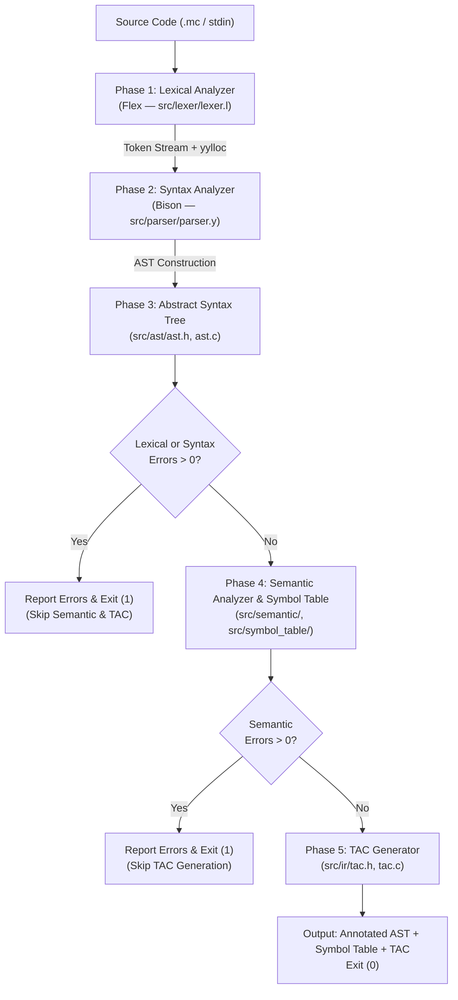
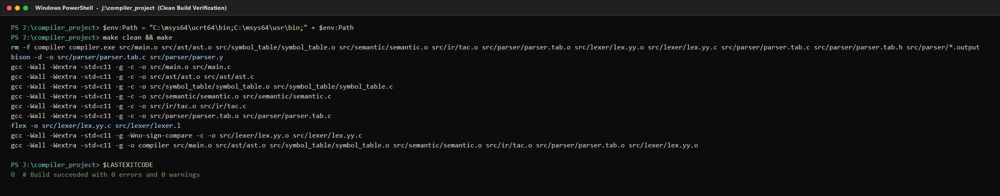
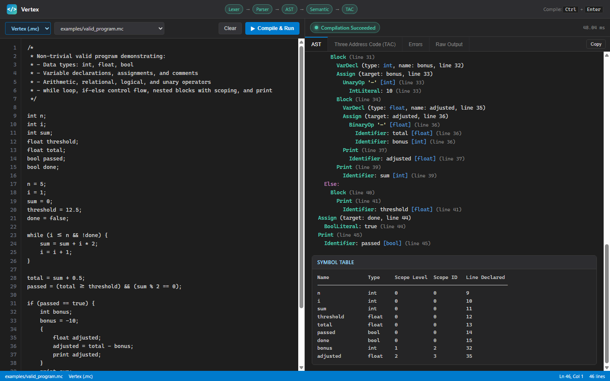
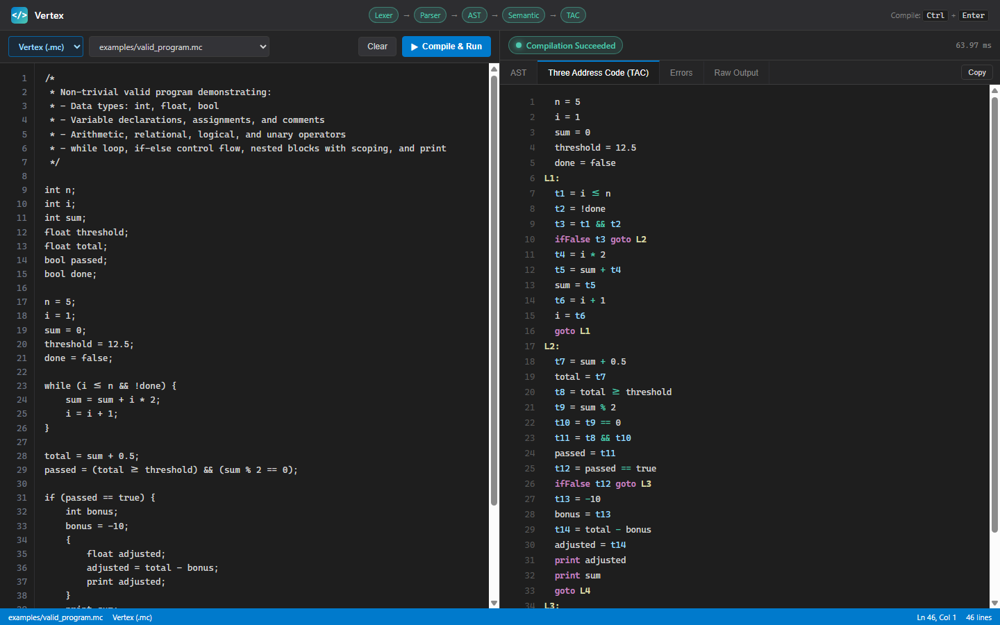
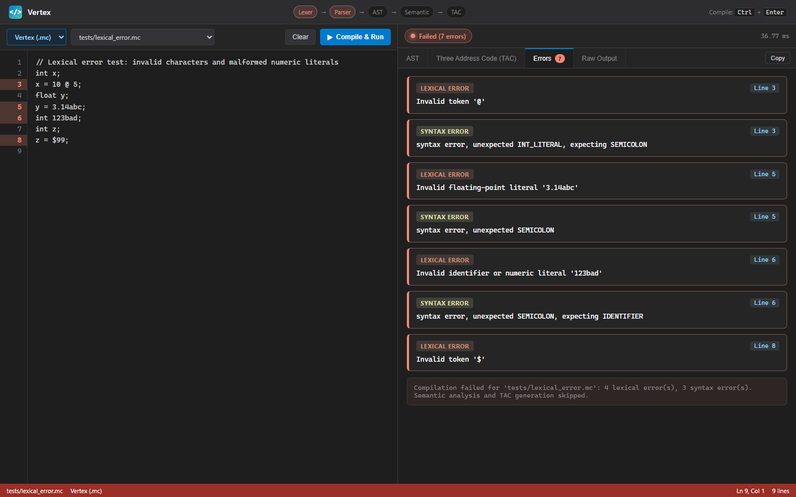
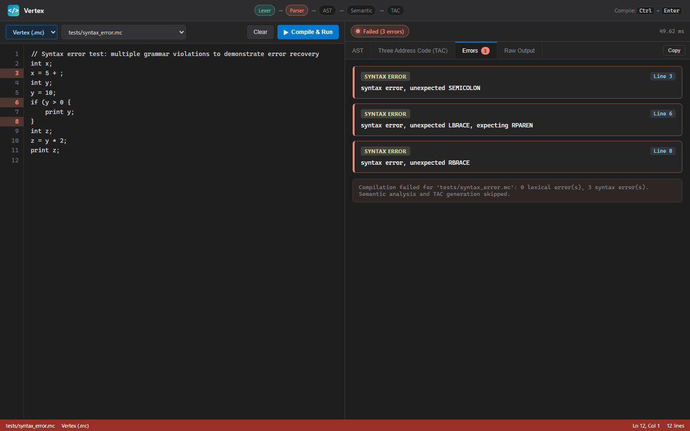
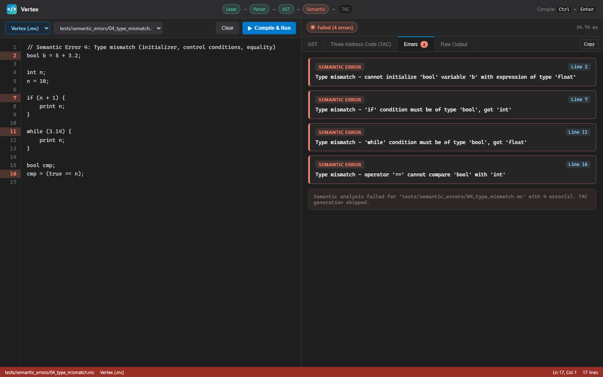

# Vertex — Mini Programming Language Compiler

## Project Report

| Item | Detail |
| :--- | :--- |
| **Project Title** | Design and Implementation of **Vertex**: A Mini Programming Language Compiler using Flex and Bison |
| **Course** | Compiler Construction Lab |
| **Department** | Department of Computer Science and Engineering |
| **Institution** | Metropolitan University, Bangladesh |
| **Implementation Stack** | C (C11), Flex, Bison, GCC, GNU Make, Python 3 / Flask (Bonus Web IDE) |

### Team Members

| Name | Student ID | Primary Responsibilities | GitHub |
| :--- | :--- | :--- | :--- |
| **Anando Das Utso** | `232-115-124` | Lexical Analyzer, Syntax Analyzer, AST Construction, Vertex Web IDE (GUI) | `@Anando-Das` |
| **Priom Dhar** | `232-115-144` | Scoped Symbol Table, Semantic Analyzer, TAC Generator, Test Suite & Documentation | `@priomdhar` |

---

## Table of Contents

1. [Introduction](#1-introduction)
2. [Objectives](#2-objectives)
3. [Language Specification](#3-language-specification)
4. [Compiler Architecture](#4-compiler-architecture)
5. [Lexer Design](#5-lexer-design)
6. [Parser Design](#6-parser-design)
7. [Abstract Syntax Tree](#7-abstract-syntax-tree)
8. [Semantic Analysis](#8-semantic-analysis)
9. [Symbol Table](#9-symbol-table)
10. [Intermediate Code Generation](#10-intermediate-code-generation)
11. [Challenges and Resolutions](#11-challenges-and-resolutions)
12. [Testing](#12-testing)
13. [Conclusion](#13-conclusion)
14. [References](#14-references)

---

## 1. Introduction

A compiler bridges the gap between human-readable high-level source code and low-level machine-oriented representations by dividing translation into well-defined, cooperating phases. While each phase—lexical analysis, syntax analysis, semantic validation, and intermediate code generation—can be studied independently in theory, building a complete front-end reveals how data structures, grammar design, error diagnostics, and intermediate representations depend tightly on one another.

**Vertex** is a complete compiler front-end with intermediate **Three Address Code (TAC)** generation implemented in C using **Flex**, **Bison**, and **GCC** for the statically typed Mini Programming Language specified in the Compiler Construction Lab Project Manual. Rather than stopping at syntax checking, Vertex constructs an explicit **Abstract Syntax Tree (AST)**, manages nested lexical scopes through a dedicated **Symbol Table**, enforces static typing and scoping rules during **Semantic Analysis**, and lowers validated programs into linear **Three Address Code**. To enhance usability and live demonstration, the project also includes the **Vertex Web IDE** (`gui/`), a dark-mode browser interface built with Python/Flask that invokes the compiled binary directly and visualizes every phase of compilation.

---

## 2. Objectives

The core objectives of the Vertex compiler project are:

1. **Tokenization (Flex):** Implement a line-tracking lexical analyzer capable of recognizing all keywords, identifiers, integer/floating-point/boolean literals, operators, and delimiters, discarding whitespace and comments, and reporting malformed tokens with exact line numbers.
2. **Unambiguous Parsing (Bison):** Design and implement a conflict-free Context-Free Grammar (CFG) encoding exact operator precedence, associativity, and dangling-else resolution, equipped with verbose diagnostics and `error`-token recovery.
3. **Structured Intermediate Tree (AST):** Build a clean, memory-safe Abstract Syntax Tree storing source line numbers and inferred types on nodes, accompanied by an indented text printer.
4. **Nested Scope Management (Symbol Table):** Implement a scoped symbol table recording each symbol's name, type, scope level, scope ID, and declaration line while enforcing block-level visibility across `{ ... }`, `if`, and `while` constructs.
5. **Static Validation (Semantic Analysis):** Detect and report all six required semantic error categories—undeclared variable use, same-scope redeclaration, scope violation, type mismatch, invalid assignment, and invalid operator expressions—without cascading spurious errors.
6. **Intermediate Code Generation (TAC):** Lower semantically validated ASTs into linear Three Address Code with temporaries (`t1`, `t2`, ...) and labels (`L1`, `L2`, ...) while strictly preventing TAC generation whenever any earlier phase reports an error.
7. **Verification & Tooling:** Validate the full pipeline against a comprehensive suite of valid and invalid test programs with saved `.out` reference outputs and provide an interactive Web IDE for live inspection.

---

## 3. Language Specification

Vertex implements the fixed Mini Programming Language specification strictly:

### 3.1 Data Types

| Type | Keyword | Literal Examples | Description |
| :--- | :--- | :--- | :--- |
| Integer | `int` | `0`, `42`, `-10` | Signed integer |
| Floating-Point | `float` | `3.14`, `0.5`, `12.5` | Double-precision floating-point literal |
| Boolean | `bool` | `true`, `false` | Logical truth value |

### 3.2 Statements & Lexical Elements

- **Variable Declarations:** `int x;`, `float y;`, `bool flag;`, and optional initialization (`bool b = 5 + 3.2;`).
- **Assignments:** `x = expr;`
- **Conditionals:** `if (expr) stmt` and `if (expr) stmt else stmt`
- **Loops:** `while (expr) stmt`
- **Output:** `print expr;`
- **Nested Blocks:** `{ stmt_list }` with isolated lexical scoping
- **Operators:**
  - Arithmetic: `+`, `-`, `*`, `/`, `%`, unary `-`
  - Relational: `<`, `>`, `<=`, `>=`, `==`, `!=`
  - Logical: `&&`, `||`, `!`
- **Delimiters:** `{`, `}`, `(`, `)`, `;`
- **Comments:** Single-line (`// ...`) and multi-line block (`/* ... */`)

### 3.3 Formal Context-Free Grammar (BNF)

The following formal CFG is extracted directly from `src/parser/parser.y`. Terminals are written in uppercase or quotes, non-terminals in `<angle_brackets>`, and `ε` denotes the empty string.

```bnf
<program>             ::= <stmt_list>

<stmt_list>           ::= ε
                        | <stmt_list> <stmt>

<stmt>                ::= <matched_stmt>
                        | <unmatched_stmt>

<matched_stmt>        ::= "if" "(" <expr> ")" <matched_stmt> "else" <matched_stmt>
                        | "while" "(" <expr> ")" <matched_stmt>
                        | <simple_stmt>
                        | <block>

<unmatched_stmt>      ::= "if" "(" <expr> ")" <stmt>
                        | "if" "(" <expr> ")" <matched_stmt> "else" <unmatched_stmt>
                        | "while" "(" <expr> ")" <unmatched_stmt>

<simple_stmt>         ::= <declaration>
                        | <assignment>
                        | <print_stmt>
                        | error ";"

<block>               ::= "{" <stmt_list> "}"
                        | "{" <stmt_list> error "}"

<type>                ::= "int" | "float" | "bool"

<declaration>         ::= <type> IDENTIFIER ";"
                        | <type> IDENTIFIER "=" <expr> ";"

<assignment>          ::= IDENTIFIER "=" <expr> ";"

<print_stmt>          ::= "print" <expr> ";"

<expr>                ::= <or_expr>

<or_expr>             ::= <and_expr>
                        | <or_expr> "||" <and_expr>

<and_expr>            ::= <equality_expr>
                        | <and_expr> "&&" <equality_expr>

<equality_expr>       ::= <relational_expr>
                        | <equality_expr> "==" <relational_expr>
                        | <equality_expr> "!=" <relational_expr>

<relational_expr>     ::= <additive_expr>
                        | <relational_expr> "<"  <additive_expr>
                        | <relational_expr> ">"  <additive_expr>
                        | <relational_expr> "<=" <additive_expr>
                        | <relational_expr> ">=" <additive_expr>

<additive_expr>       ::= <multiplicative_expr>
                        | <additive_expr> "+" <multiplicative_expr>
                        | <additive_expr> "-" <multiplicative_expr>

<multiplicative_expr> ::= <unary_expr>
                        | <multiplicative_expr> "*" <unary_expr>
                        | <multiplicative_expr> "/" <unary_expr>
                        | <multiplicative_expr> "%" <unary_expr>

<unary_expr>          ::= <primary_expr>
                        | "-" <unary_expr>
                        | "!" <unary_expr>

<primary_expr>        ::= INT_LITERAL
                        | FLOAT_LITERAL
                        | BOOL_LITERAL
                        | IDENTIFIER
                        | "(" <expr> ")"
```

---

## 4. Compiler Architecture

### 4.1 Pipeline Diagram



### 4.2 Module Interaction

The driver in `src/main.c` orchestrates all modules in strict sequential order:

| Module | Source Files | Responsibility | Output Passed Downstream |
| :--- | :--- | :--- | :--- |
| **Driver** | `src/main.c` | Opens input file (or `stdin`), runs `yyparse()`, gates each phase on zero prior errors, prints outputs, frees all memory | Exit code `0` (success) or `1` (failure) |
| **Lexer** | `src/lexer/lexer.l` | Produces tokens, fills `yylval` and `yylloc`, increments `lexical_errors` on invalid input | Tokens to `yyparse()` |
| **Parser** | `src/parser/parser.y` | Validates token stream against CFG, builds AST via `ast_create_*`, increments `syntax_errors` | Root `ASTNode *ast_root` |
| **AST** | `src/ast/ast.h`, `src/ast/ast.c` | Defines node structures, builders, `ast_print()`, and `ast_free()` | Shared tree for Semantic & IR phases |
| **Symbol Table** | `src/symbol_table/symbol_table.h`, `.c` | Manages nested scope stack, symbol lookup/insertion, out-of-scope lookup, table printer | `SymbolTable *symtab` |
| **Semantic Analyzer** | `src/semantic/semantic.h`, `.c` | Walks AST, validates scopes and types, annotates `node->eval_type` | Error count (`0` to proceed) + Annotated AST |
| **TAC Generator** | `src/ir/tac.h`, `src/ir/tac.c` | Walks validated AST, emits linear TAC instructions with temporaries and labels | `TACList *tac` printed via `tac_print()` |

### 4.3 Bonus Features Implemented

In addition to meeting 100% of the mandatory requirements, Vertex includes four bonus enhancements:

1. **Vertex Web IDE (GUI — `gui/app.py`, `gui/templates/index.html`, `gui/requirements.txt`):**
   - A VS Code-inspired dark-mode web frontend served via Python Flask on `http://127.0.0.1:5000`.
   - Provides a line-numbered editor with red error-line gutter highlights, clickable error cards that jump directly to the offending line, live pipeline phase status pills (`Lexer → Parser → AST → Semantic → TAC`), one-click sample loader reading `examples/` and `tests/`, and syntax-highlighted **AST + Symbol Table**, **Three Address Code (TAC)**, **Errors**, and **Raw Output** tabs.
   - Includes a 3-mode language selector supporting **Vertex (`.mc`)** (calling `./compiler`), **C++ (`.cpp`)** (via `g++` with a 5-second execution timeout), and **Java (`.java`)** (via `javac`/`java` with a 5-second execution timeout).
2. **Unary Operators (`-` and `!`):** Full lexer, parser (right-associative `unary_expr`), AST (`AST_UNARY_OP`), semantic type checking, and TAC lowering (`t1 = -5`, `t2 = !done`).
3. **Variable Declaration Initializers:** Supports both `int x;` and initialized declarations such as `bool b = 5 + 3.2;`, enabling direct semantic checking of Section 4.5's exact type-mismatch example as well as TAC emission for valid initializers.
4. **Improved Bison Error Recovery:** Combines statement-level recovery (`error SEMICOLON`) with block-level recovery (`LBRACE stmt_list error RBRACE`) at zero grammar conflicts so multiple syntax errors in a single file are reported in one pass.

---

## 5. Lexer Design

The lexical analyzer is implemented in `src/lexer/lexer.l` using **Flex**.

### 5.1 Flex Configuration & Line Synchronization

```c
%option noyywrap
%option yylineno
%option nounput
%option noinput
%x COMMENT
```

- `%option yylineno` automatically tracks the current line number across newlines.
- `%option nounput noinput` suppresses unused Flex helper functions so `gcc -Wall -Wextra` compiles cleanly with zero warnings.
- `#define YY_USER_ACTION yylloc.first_line = yylloc.last_line = yylineno;` keeps Bison's location tracking (`yylloc`) synchronized with every matched token so every AST node and syntax error records the exact token line.

### 5.2 Token Definitions & Regular Expressions

| Category | Pattern (Regex) | Returned Token / Action |
| :--- | :--- | :--- |
| Single-line comment | `"//"[^\r\n]*` | Discarded |
| Block comment | `"/*"` → `<COMMENT>` → `"*/"` | Discarded via exclusive start state `%x COMMENT`; `<COMMENT><<EOF>>` reports `Unterminated block comment` with `comment_start_line` |
| Whitespace | `[ \t\r\n]+` | Discarded |
| Keywords | `"int"`, `"float"`, `"bool"`, `"if"`, `"else"`, `"while"`, `"print"` | `KW_INT`, `KW_FLOAT`, `KW_BOOL`, `KW_IF`, `KW_ELSE`, `KW_WHILE`, `KW_PRINT` |
| Boolean literals | `"true"`, `"false"` | `BOOL_LITERAL` (`yylval.bool_val = 1` / `0`) |
| Multi-char operators | `"=="`, `"!="`, `"<="`, `">="`, `"&&"`, `"||"` | `OP_EQ`, `OP_NEQ`, `OP_LE`, `OP_GE`, `OP_AND`, `OP_OR` |
| Single-char operators | `"+"`, `"-"`, `"*"`, `"/"`, `"%"`, `"<"`, `">"`, `"!"`, `"="` | `OP_PLUS`, `OP_MINUS`, `OP_MUL`, `OP_DIV`, `OP_MOD`, `OP_LT`, `OP_GT`, `OP_NOT`, `OP_ASSIGN` |
| Delimiters | `"{"`, `"}"`, `"("`, `")"`, `";"` | `LBRACE`, `RBRACE`, `LPAREN`, `RPAREN`, `SEMICOLON` |
| Float literal | `[0-9]+"."[0-9]+` | `FLOAT_LITERAL` (`atof(yytext)`) |
| Integer literal | `[0-9]+` | `INT_LITERAL` (`atoi(yytext)`) |
| Identifier | `[a-zA-Z_][a-zA-Z0-9_]*` | `IDENTIFIER` (`lex_strdup(yytext)`) |
| Malformed literals | `{FLOAT_LIT}({LETTER}\|".")...`, `{INT_LIT}{LETTER}...`, `{DIGIT}+"."`, `"."{DIGIT}+` | Reports lexical error with line number (`3.14abc`, `123bad`, `3.`, `.5`) and increments `lexical_errors` |
| Invalid character | `.` | Reports `Lexical Error at line <N>: Invalid token '<c>'` and increments `lexical_errors` |

### 5.3 Key Design Decisions

- **Rule Ordering:** Keyword rules appear before `{ID}`, and two-character operators (`<=`, `>=`, `==`, `!=`, `&&`, `||`) appear before single-character operators (`<`, `>`, `=`, `!`) so Flex's longest-match and first-match rules resolve every token unambiguously.
- **Malformed Literal Capture:** Catching patterns such as `123bad` and `3.14abc` as explicit lexical errors prevents the lexer from silently splitting them into two separate tokens (`123` + `bad`).
- **C11 Portability:** A custom `lex_strdup()` helper replaces POSIX `strdup()` so the generated lexer compiles cleanly under strict `-std=c11` on both Linux GCC and Windows MinGW/UCRT64.

---

## 6. Parser Design

The syntax analyzer is implemented in `src/parser/parser.y` using **GNU Bison**.

### 6.1 Precedence and Associativity Hierarchy

Instead of relying solely on Bison `%left`/`%right` precedence overrides over an ambiguous expression grammar, Vertex encodes operator precedence and associativity **directly in the CFG productions**:

| Precedence Level | Non-Terminal | Operators | Associativity |
| :---: | :--- | :--- | :--- |
| 1 (Lowest) | `or_expr` | `\|\|` | Left-associative |
| 2 | `and_expr` | `&&` | Left-associative |
| 3 | `equality_expr` | `==`, `!=` | Left-associative |
| 4 | `relational_expr` | `<`, `>`, `<=`, `>=` | Left-associative |
| 5 | `additive_expr` | `+`, `-` | Left-associative |
| 6 | `multiplicative_expr` | `*`, `/`, `%` | Left-associative |
| 7 | `unary_expr` | Unary `-`, `!` | Right-associative |
| 8 (Highest) | `primary_expr` | Literals, identifiers, `( expr )` | — |

Left-recursion (`additive_expr : additive_expr OP_PLUS multiplicative_expr`) guarantees left-associativity (`a - b - c` parses as `(a - b) - c`), while right-recursion (`unary_expr : OP_NOT unary_expr`) guarantees right-associativity (`!!flag` parses as `!(!flag)`).

### 6.2 Dangling-Else Resolution & Zero Conflicts

Classic `if-else` grammars suffer from a shift/reduce conflict on `else`. Vertex eliminates this ambiguity formally by splitting statements into `matched_stmt` (every `if` inside has a matching `else`) and `unmatched_stmt` (contains an open `if` without an `else`):

- An `if (...) <stmt> else ...` requires the `then`-branch to be a `matched_stmt`, ensuring every `else` binds strictly to the nearest preceding unmatched `if`.
- Running `bison -d -o src/parser/parser.tab.c src/parser/parser.y` produces **0 shift/reduce conflicts** and **0 reduce/reduce conflicts**.

### 6.3 Error Reporting and Recovery

- `%locations` and `%define parse.error verbose` enable detailed diagnostics such as `Syntax Error at line 6: syntax error, unexpected LBRACE, expecting RPAREN`.
- Two conflict-free `error` productions provide multi-error recovery:
  1. `simple_stmt : error SEMICOLON { yyerrok; $$ = NULL; }` — discards tokens up to the next `;` and resumes parsing subsequent statements.
  2. `block : LBRACE stmt_list error RBRACE { yyerrok; ast_free($2); $$ = NULL; }` — synchronizes at a closing `}` without conflicting with `simple_stmt`'s `error SEMICOLON` (since `SEMICOLON` and `RBRACE` are disjoint lookaheads after shifting `error`).

---

## 7. Abstract Syntax Tree

The AST module (`src/ast/ast.h`, `src/ast/ast.c`) strips away concrete syntactic tokens (semicolons, parentheses, keywords) and represents the program as a clean, typed tree passed to both the semantic analyzer and TAC generator.

### 7.1 Node Structure

Every `ASTNode` contains four common header fields followed by a discriminated `union`:

```c
typedef struct ASTNode {
    ASTNodeType type;      /* Node kind (13 variants) */
    int line;              /* Source line where the construct starts */
    DataType eval_type;    /* Inferred type populated during semantic analysis */
    struct ASTNode *next;  /* Linked-list link for statement lists */
    union { ... } data;    /* Variant-specific payload */
} ASTNode;
```

### 7.2 Complete AST Node Inventory

| `ASTNodeType` | Payload Fields | Purpose |
| :--- | :--- | :--- |
| `AST_PROGRAM` | `block.statements` | Root container holding the top-level statement list |
| `AST_BLOCK` | `block.statements` | Lexical block `{ ... }` introducing a new scope |
| `AST_VAR_DECL` | `var_type`, `name`, `init_expr` (optional) | Variable declaration (`int x;` or `bool b = 5 + 3.2;`) |
| `AST_ASSIGN` | `name`, `value` | Variable assignment (`x = expr;`) |
| `AST_IF` | `condition`, `then_branch`, `else_branch` (nullable) | `if` and `if-else` statements |
| `AST_WHILE` | `condition`, `body` | `while` loop statement |
| `AST_PRINT` | `expr` | `print expr;` output statement |
| `AST_BINARY_OP` | `op` (`BinaryOp`), `left`, `right` | Binary arithmetic, relational, and logical operations |
| `AST_UNARY_OP` | `op` (`UnaryOp`), `operand` | Unary negation (`-`) and logical NOT (`!`) |
| `AST_INT_LITERAL` | `int_lit.value` | Integer constant (`eval_type = TYPE_INT`) |
| `AST_FLOAT_LITERAL` | `float_lit.value` | Floating-point constant (`eval_type = TYPE_FLOAT`) |
| `AST_BOOL_LITERAL` | `bool_lit.value` | Boolean constant (`eval_type = TYPE_BOOL`) |
| `AST_IDENTIFIER` | `ident.name` | Variable reference (annotated with declared type in Phase 4) |

### 7.3 Construction, Printing, and Cleanup

- **Construction:** Dedicated constructors (`ast_create_program`, `ast_create_block`, `ast_create_var_decl`, `ast_create_assign`, `ast_create_if`, `ast_create_while`, `ast_create_print`, `ast_create_binary_op`, `ast_create_unary_op`, `ast_create_*_literal`, `ast_create_identifier`) allocate zero-initialized nodes and record `@1.first_line` (or `@2.first_line` for binary operators). `ast_append_stmt()` ignores `NULL` nodes produced by error recovery.
- **Visualization:** `ast_print(const ASTNode *node, int indent)` outputs a readable 2-space indented hierarchy showing inferred types (e.g., `BinaryOp '+' [float] (line 28)`).
- **Memory Safety:** `ast_free()` iteratively walks statement lists and recursively frees all child subtrees and heap-allocated identifier strings.

---

## 8. Semantic Analysis

Implemented in `src/semantic/semantic.h` and `src/semantic/semantic.c`, the semantic analyzer performs a depth-first traversal over the AST (`semantic_analyze(ASTNode *root, SymbolTable *symtab)`), populating the symbol table, validating all static rules, annotating `node->eval_type`, and returning the total error count.

### 8.1 Static Type-Checking Rules

| Construct / Operator | Valid Operand Types | Resulting Type | Rejected Cases |
| :--- | :--- | :--- | :--- |
| `+`, `-`, `*`, `/` | Both numeric (`int` or `float`) | `float` if either operand is `float`, else `int` | Any `bool` operand |
| `%` | Both `int` | `int` | `float` or `bool` operands |
| Unary `-` | Numeric (`int` or `float`) | Same as operand | `bool` operand |
| `&&`, `\|\|` | Both `bool` | `bool` | Any numeric operand |
| Unary `!` | `bool` | `bool` | Any numeric operand |
| `<`, `>`, `<=`, `>=` | Both numeric (`int` or `float`) | `bool` | Any `bool` operand |
| `==`, `!=` | Both numeric, OR both `bool` | `bool` | Comparing `bool` with `int`/`float` |
| `if (cond)` / `while (cond)` | `cond` must be `bool` | — | `int` or `float` conditions |
| Assignment & Initializer (`is_assignable`) | Exact type match, or safe widening `int → float` | Target variable type | Narrowing `float → int`, or any `bool ↔ numeric` assignment |

### 8.2 Detection of All Six Required Error Categories

1. **Undeclared Variable Use:** `resolve_identifier()` checks the active scope chain via `symtab_lookup()`. If absent from both active and exited scopes, it emits `Semantic Error at line <N>: Undeclared variable '<name>'`.
2. **Redeclaration in Same Scope:** On `AST_VAR_DECL`, `symtab_lookup_current_scope()` checks only the innermost active scope. Duplicate names in the same scope emit `Redeclaration of variable '<name>' in the same scope (previously declared at line <M>)`, while inner-block shadowing of an outer variable remains valid.
3. **Scope Violation:** If `symtab_lookup()` fails, `resolve_identifier()` queries `symtab_lookup_out_of_scope()`. If the identifier was declared inside a previously closed block (`{ ... }`, `if`, or `while`), it emits a specific diagnostic: `Scope violation - variable '<name>' (declared at line <M> in inner scope level <L>) is not visible outside its block`. Furthermore, `analyze_branch_with_scope()` wraps non-block single-statement `if`/`while` bodies in their own scope so declarations can never leak out.
4. **Type Mismatch:** Enforced on variable initializers (`bool b = 5 + 3.2;`), `if`/`while` conditions (`if (n + 1)`), and equality comparisons (`true == n`).
5. **Invalid Assignment:** Enforced on `AST_ASSIGN` via `is_assignable(entry->type, rhs_type)` (rejecting `bool → int`, `float → int`, `bool → float`, `int/float → bool`).
6. **Invalid Expressions:** Enforced in `analyze_binary_op()` and `analyze_unary_op()` for every arithmetic, modulo, relational, logical, and unary operator.

### 8.3 Error Cascade Suppression (`TYPE_ERROR`)

When an expression fails semantic validation (for example, referencing an undeclared variable `u` in `x = u + 1;`), its `eval_type` is marked `TYPE_ERROR`. Parent expression and assignment checks test for `TYPE_ERROR` and propagate it silently without reporting redundant downstream type errors, keeping diagnostics concise and accurate.

---

## 9. Symbol Table

Implemented in `src/symbol_table/symbol_table.h` and `src/symbol_table/symbol_table.c`, the symbol table supports arbitrary nesting depths while retaining full metadata for diagnostics and reporting.

### 9.1 Data Structure Design

```c
typedef struct SymbolEntry {
    char *name;
    DataType type;
    int scope_level;
    int scope_id;
    int line_declared;
    struct SymbolEntry *next;
} SymbolEntry;

typedef struct Scope {
    int scope_level;
    int scope_id;
    int is_active;
    struct Scope *parent;     /* Active lexical scope stack link */
    struct Scope *all_next;   /* Archived history link across all scopes */
    SymbolEntry *symbols;     /* Symbols declared in this scope */
} Scope;
```

### 9.2 Scope-Handling Strategy

- **Initialization (`symtab_create`):** Creates the global scope (`scope_level = 0`, `scope_id = 0`, `parent = NULL`).
- **Entering a Block (`symtab_enter_scope`):** Allocates a child `Scope` with `scope_level = current->scope_level + 1` and a unique monotonically increasing `scope_id`, links `child->parent = current`, appends it to the flat history list (`all_scopes_tail`), and updates `current_scope = child`.
- **Exiting a Block (`symtab_exit_scope`):** Marks `current_scope->is_active = 0` and pops `current_scope = current_scope->parent`. Exited scopes are retained until `symtab_destroy()` so that:
  1. `symtab_lookup_out_of_scope()` can pinpoint exact scope violations with original declaration line and level.
  2. `symtab_print()` displays a complete, ordered summary table of every variable declared across all scopes (global and nested) at the end of successful compilation.
- **Lookup Operations:**
  - `symtab_lookup()`: Walks `current_scope → parent → ... → global` (innermost declaration wins, supporting lexical shadowing).
  - `symtab_lookup_current_scope()`: Inspects only `current_scope` to enforce same-scope redeclaration checks.

---

## 10. Intermediate Code Generation

Implemented in `src/ir/tac.h` and `src/ir/tac.c`, Phase 5 translates the validated AST into linear **Three Address Code (TAC)** instructions stored in a `TACList` linked list.

### 10.1 Instruction Set & Translation Strategy

| `TACOp` | Printed Form | Generated For |
| :--- | :--- | :--- |
| `TAC_ASSIGN` | `x = arg1` | Variable assignments and initialized declarations |
| `TAC_BINARY` | `tN = arg1 op arg2` | Arithmetic, relational, and logical binary operations |
| `TAC_UNARY` | `tN = op arg1` | Unary negation (`-`) and logical NOT (`!`) |
| `TAC_LABEL` | `Lk:` | Branch and loop targets |
| `TAC_GOTO` | `goto Lk` | Unconditional jumps (`else` skip, `while` loop back-edge) |
| `TAC_IF_FALSE` | `ifFalse tN goto Lk` | Conditional branch on false predicate |
| `TAC_PRINT` | `print arg1` | `print expr;` statements |

- **Temporaries & Labels:** Generated sequentially via `new_temp()` (`t1`, `t2`, ...) and `new_label()` (`L1`, `L2`, ...).
- **Control Flow Templates:**
  - **`if (cond) S1`:** Evaluate `cond → t`; emit `ifFalse t goto L_end`; emit `S1`; emit `L_end:`.
  - **`if (cond) S1 else S2`:** Evaluate `cond → t`; emit `ifFalse t goto L_else`; emit `S1`; emit `goto L_end`; emit `L_else:`; emit `S2`; emit `L_end:`.
  - **`while (cond) S`:** Emit `L_start:`; evaluate `cond → t`; emit `ifFalse t goto L_end`; emit `S`; emit `goto L_start`; emit `L_end:`.
- **Error Gating:** `src/main.c` invokes `tac_generate(ast_root)` **only** if `lexical_errors == 0`, `syntax_errors == 0`, and `semantic_errors == 0`.

### 10.2 Actual Input & Generated TAC Example (`examples/valid_program.mc`)

**Input (`examples/valid_program.mc`):**

```c
int n;
int i;
int sum;
float threshold;
float total;
bool passed;
bool done;

n = 5;
i = 1;
sum = 0;
threshold = 12.5;
done = false;

while (i <= n && !done) {
    sum = sum + i * 2;
    i = i + 1;
}

total = sum + 0.5;
passed = (total >= threshold) && (sum % 2 == 0);

if (passed == true) {
    int bonus;
    bonus = -10;
    {
        float adjusted;
        adjusted = total - bonus;
        print adjusted;
    }
    print sum;
} else {
    print threshold;
}

done = true;
print passed;
```

**Actual Generated TAC Output (verified verbatim from `examples/valid_program.out`):**

```text
  n = 5
  i = 1
  sum = 0
  threshold = 12.5
  done = false
L1:
  t1 = i <= n
  t2 = !done
  t3 = t1 && t2
  ifFalse t3 goto L2
  t4 = i * 2
  t5 = sum + t4
  sum = t5
  t6 = i + 1
  i = t6
  goto L1
L2:
  t7 = sum + 0.5
  total = t7
  t8 = total >= threshold
  t9 = sum % 2
  t10 = t9 == 0
  t11 = t8 && t10
  passed = t11
  t12 = passed == true
  ifFalse t12 goto L3
  t13 = -10
  bonus = t13
  t14 = total - bonus
  adjusted = t14
  print adjusted
  print sum
  goto L4
L3:
  print threshold
L4:
  done = true
  print passed
```

Notice how `sum = sum + i * 2;` properly evaluates `t4 = i * 2` before `t5 = sum + t4` (operator precedence), `while` uses `L1`/`L2` with `ifFalse` and `goto L1`, and `if-else` uses `L3`/`L4`.

---

## 11. Challenges and Resolutions

| # | Technical Challenge | Resolution Implemented |
| :-: | :--- | :--- |
| 1 | **Dangling-else shift/reduce conflict & error recovery conflicts in Bison** | Replaced naive `if` rules with formal `matched_stmt` / `unmatched_stmt` stratification and placed block recovery as `LBRACE stmt_list error RBRACE` (disjoint lookahead from `error SEMICOLON`), achieving **0 shift/reduce and 0 reduce/reduce conflicts**. |
| 2 | **Inaccurate line numbers on multi-line AST nodes (`if`, `while`, blocks)** | Relying on `yylineno` inside reduction actions reports the *closing* line of a block. Enabled Bison `%locations` and synchronized `yylloc` via Flex `YY_USER_ACTION`, recording `@1.first_line` on every AST node. |
| 3 | **Distinguishing scope violations from undeclared variables** | Popping and freeing exited scopes immediately would erase knowledge of inner-block variables. Retaining exited scopes with `is_active = 0` in `all_scopes_head` enabled `symtab_lookup_out_of_scope()` to emit explicit scope-violation messages citing the original declaration line and scope level. |
| 4 | **Header dependency between `parser.tab.h` and `ast.h`** | Bison's `%union` references `ASTNode *` and `DataType`. Placing `#include "../ast/ast.h"` inside `%code requires { ... }` guarantees `parser.tab.h` is self-contained for both `parser.tab.c` and `lex.yy.c`. |
| 5 | **Cascading semantic error messages** | Introduced `TYPE_ERROR` as an error-propagation sentinel so an undeclared variable or malformed subexpression reports its root cause once without triggering spurious type-mismatch errors on enclosing expressions. |
| 6 | **Strict C11 & Windows/Linux portability + Web IDE TAC highlighting bug** | Replaced POSIX `strdup` with custom `*_strdup` helpers, added `-Wno-sign-compare` only on Flex-generated `lex.yy.c` for a zero-warning `-Wall -Wextra -std=c11` build, and refactored `formatTacHtml()` in `gui/templates/index.html` into a single-pass tokenizer regex so operators never match hyphens inside HTML class attributes. |

---

## 12. Testing

### 12.1 Clean Build Verification

Running `make clean && make` compiles all modules cleanly with **0 errors, 0 warnings, and 0 Bison conflicts**:



### 12.2 Complete Test Suite Results (13 / 13 Passed)

Every test program in `examples/` and `tests/` is paired with a `.out` file containing its verified compiler output. All 13 programs were executed against `./compiler` and matched their `.out` files byte-for-byte:

| # | Test File | Category | Expected | Exit Code | Paired `.out` | Key Verified Output / Diagnostic | Status |
| :-: | :--- | :--- | :---: | :---: | :---: | :--- | :---: |
| 1 | `examples/sample.mc` | Valid (Manual §5.5) | Pass | `0` | `sample.out` | Clean AST, Symbol Table (3 vars), TAC (`L1`–`L4`, `t1`–`t4`) | **PASS** |
| 2 | `examples/valid_program.mc` | Valid (Comprehensive) | Pass | `0` | `valid_program.out` | Clean AST, Symbol Table (scope levels 0–2), TAC (`L1`–`L4`, `t1`–`t14`) | **PASS** |
| 3 | `tests/valid_basic.mc` | Valid (Basic & Prec.) | Pass | `0` | `valid_basic.out` | Verifies `2 + 3 * 4 - 10 / 2 % 3` precedence & comments | **PASS** |
| 4 | `tests/valid_nested_and_ops.mc` | Valid (Nested & Ops) | Pass | `0` | `valid_nested_and_ops.out` | Verifies dangling-else, nested blocks, unary `-`/`!`, logical ops | **PASS** |
| 5 | `tests/valid_tac_manual.mc` | Valid (Manual §4.6) | Pass | `0` | `valid_tac_manual.out` | Matches manual TAC (`t1 = b * 2`, `t2 = a + t1`, `c = t2`) | **PASS** |
| 6 | `tests/lexical_error.mc` | Lexical Error | Fail | `1` | `lexical_error.out` | Catches `@` (L3), `3.14abc` (L5), `123bad` (L6), `$` (L8); TAC skipped | **PASS** |
| 7 | `tests/syntax_error.mc` | Syntax Error & Recovery | Fail | `1` | `syntax_error.out` | Catches L3 (`;`), recovers to catch L6 (`{`) and L8 (`}`); TAC skipped | **PASS** |
| 8 | `tests/semantic_errors/01_undeclared_variable.mc` | Semantic (Undeclared) | Fail | `1` | `01_undeclared_variable.out` | `Undeclared variable 'b'` (L4), `'c'` (L5); TAC skipped | **PASS** |
| 9 | `tests/semantic_errors/02_redeclaration.mc` | Semantic (Redeclaration) | Fail | `1` | `02_redeclaration.out` | Permits inner shadowing; catches redecl at L8 (prev L6) & L10 (prev L2) | **PASS** |
| 10 | `tests/semantic_errors/03_scope_violation.mc` | Semantic (Scope Violation) | Fail | `1` | `03_scope_violation.out` | Catches `block_var` (L10), `if_var` (L17), `while_var` (L24) | **PASS** |
| 11 | `tests/semantic_errors/04_type_mismatch.mc` | Semantic (Type Mismatch) | Fail | `1` | `04_type_mismatch.out` | Catches `bool b = 5 + 3.2;` (L2), `if (n+1)` (L7), `while (3.14)` (L11), `true == n` (L16) | **PASS** |
| 12 | `tests/semantic_errors/05_invalid_assignment.mc` | Semantic (Invalid Assign) | Fail | `1` | `05_invalid_assignment.out` | Catches `bool→int`, `float→int`, `bool→float`, `int/float→bool` (L6–L10) | **PASS** |
| 13 | `tests/semantic_errors/06_invalid_expression.mc` | Semantic (Invalid Expr) | Fail | `1` | `06_invalid_expression.out` | Catches `&&`/`\|\|`/`!` on numbers, `+`/`*`/`-`/`<` on bools, `%` on float | **PASS** |

### 12.3 Verification Screenshots (Vertex Web IDE)

#### Valid Program Compilation — Annotated AST & Symbol Table (`examples/valid_program.mc`)


#### Valid Program Compilation — Generated Three Address Code (`examples/valid_program.mc`)


#### Lexical Error Detection (`tests/lexical_error.mc`)


#### Syntax Error Detection & Bison Error Recovery (`tests/syntax_error.mc`)


#### Semantic Error Diagnostics (`tests/semantic_errors/04_type_mismatch.mc`)


---

## 13. Conclusion

Designing and implementing **Vertex** demonstrated firsthand how every phase of a compiler front-end collaborates as a cohesive pipeline. Starting from regular-expression tokenization in Flex and a formally unambiguous, conflict-free Bison CFG, the project builds a line-tracked AST, enforces nested lexical scoping and static typing with zero error cascades, and lowers valid programs into clean Three Address Code.

All mandatory modules compile with zero warnings under strict C11 flags and pass 100% of our 13-program valid and error test suite. Beyond the core requirements, the interactive **Vertex Web IDE** provides immediate visual feedback on every phase of compilation, making the compiler easy to explore, test, and demonstrate live. Future extensions could build directly on Vertex's structured `ASTNode` and `TACList` representations to add constant folding, dead-code elimination, user-defined functions, arrays, or Graphviz AST export.

---

## 14. References

1. A. V. Aho, M. S. Lam, R. Sethi, and J. D. Ullman, *Compilers: Principles, Techniques, and Tools* (2nd Edition), Pearson Education, 2006.
2. J. Levine, *flex & bison: Text Processing Tools*, O'Reilly Media, 2009.
3. GNU Bison Manual (Version 3.8): https://www.gnu.org/software/bison/manual/
4. Flex — The Fast Lexical Analyzer Manual (Version 2.6.4): https://westes.github.io/flex/manual/
5. ISO/IEC 9899:2011 (C11 Programming Language Standard) & GCC Documentation: https://gcc.gnu.org/onlinedocs/
6. Flask Web Framework Documentation: https://flask.palletsprojects.com/
7. Department of CSE, Metropolitan University, Bangladesh — *Compiler Construction Lab: Project Manual*.
